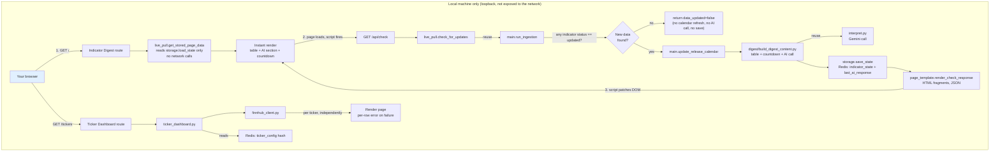
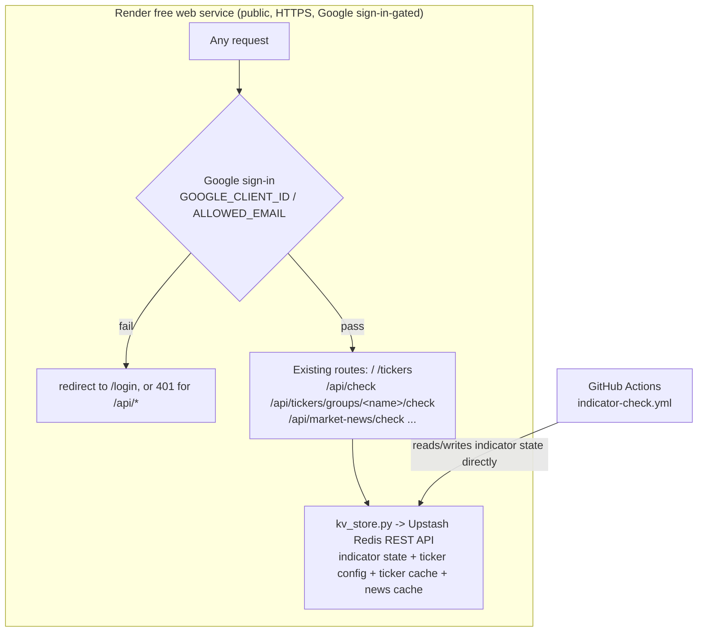

# V2 Technical Design — Web Dashboard

**Companion to:** investment_dashboard_requirements.md, v2_user_stories.md, v1_technical_design.md
**Adds to the v1 stack:** Flask (local web server) · Finnhub API (ticker price/52-week range)
**Hosting:** local-only — `localhost`, bound to loopback only, started on demand

**Product shape:** v2 adds two web pages served by one local Flask app: the **Indicator Digest Page** (a browsable, live-refreshing version of the v1 digest email) and the **Ticker Dashboard** (new content). Both reuse v1's existing modules rather than duplicating logic — see Section 3.

---

## 1. Architecture Overview



**Why this shape:** the Indicator Digest Page drives the *same* ingestion and interpretation code the v1 email already uses, so the two surfaces can never disagree about "current." It's split into a fast synchronous path (`/`, stored data only) and a background path (`/api/check`, the actual live pull) so the reader never waits on FRED or Gemini, and a check that finds nothing new costs a FRED call but never a Gemini call. The Ticker Dashboard is genuinely new (Finnhub, not FRED) but follows the same pattern: a thin route handler, a data-assembly module, per-item error isolation.

## 2. Repository Structure (additions to v1)

```
/
# config/tickers.json and data/*.json (originally: watchlist + ticker/news/
# indicator caches) were deleted from the repo on 2026-09-16 — everything
# lives in Redis only now (ticker_config, ticker_cache, market_news_cache,
# indicator_state), see Section 11.10.
├── src/
│   ├── web/
│   │   ├── app.py                 # Flask app: GET / and GET /tickers (fast renders), GET /api/check
│   │   │                          #   (background live pull) and, per ticker group, GET
│   │   │                          #   /api/tickers/groups/<name>/check plus GET /api/market-news/check
│   │   ├── live_pull.py           # Indicator Digest Page: stored-only render + gated background check
│   │   ├── page_template.py       # HTML rendering for both pages (plain string-building, matching
│   │   │                          #   mailer/email_template.py's convention); page scripts are plain
│   │   │                          #   JavaScript files in static/js/, loaded by script_tag()
│   │   ├── ticker_dashboard.py    # config loading, per-ticker card assembly, stored-render/live-check split
│   │   └── finnhub_client.py      # Finnhub API wrapper: quote, 52-week range (NOT candles — see 5.1)
│   ├── digest/
│   │   ├── build_digest_content.py  # builds {table, countdown, ai_result} from state — called by both
│   │   │                            #   post_release.py (weekly-throttled email) and live_pull.py (every
│   │   │                            #   page load), so table/countdown/AI-assembly logic lives in one place
│   │   ├── post_release.py        # calls build_digest_content(); throttle + email-send logic unchanged
│   │   ├── interpret.py           # (existing) — caller now persists the result
│   │   └── heuristics.py          # (existing, unchanged)
├── static/
│   └── dashboard.css              # served by Flask, plain CSS, no framework
└── run_web.sh                     # convenience script: activates venv, starts Flask on 127.0.0.1
```

No changes to `.github/workflows/indicator-check.yml` or the existing `fred/`, `storage/`, `mailer/` modules beyond what's noted above.

## 3. Data Schema Changes

### 3.1 `data/indicators.json` — `last_ai_response` field

v1 generated the AI summary fresh for each email and never persisted it. The Indicator Digest Page's fallback path needs a persisted copy to show when a live pull fails:

```json
{
  "last_digest_sent_at": "2026-09-04T14:00:00+00:00",
  "last_ai_response": {
    "summary": "Jobless claims ticked up while CPI cooled, suggesting...",
    "computed_reads": {"leading": "neutral", "coincident": "neutral", "lagging": "neutral"},
    "generated_at": "2026-09-12T18:03:11+00:00"
  },
  "indicators": { "...": "unchanged from v1" }
}
```

- `last_ai_response` is overwritten (not appended) on every successful Gemini call — both from the weekly email (`post_release.py`) and from a page-triggered live pull (`live_pull.py`). Both call sites go through `build_digest_content()`, so this is one code path.
- If a live pull's Gemini call fails but the FRED fetch succeeds, `last_ai_response` is left untouched and the page falls back to it, labeled with its own `generated_at`.

### 3.2 `ticker_config` (originally `config/tickers.json`, superseded — see Section 11.10)

Originally a committed local file; as of the 2026-09-16 simplification (Section 11.10) the file was deleted and its content lives only in the `ticker_config` Redis hash. The logical shape is unchanged:

```json
{
  "groups": {
    "stocks": ["AAA", "BBB"],
    "bonds": ["CCC"],
    "international": ["DDD"],
    "sector": ["EEE"],
    "individual": ["FFF", "GGG"]
  }
}
```

`groups` is read as an open map — `ticker_dashboard.py` iterates whatever keys are present, in config order, rather than a fixed set of expected group names. **No group name may ever be hardcoded** in `ticker_dashboard.py` or `page_template.py`; both derive section headers directly from these keys.

Loaded fresh on every request to `/tickers` — an edit (via the in-app editor; there's no file to hand-edit anymore) takes effect on the next page reload with no restart required.

## 4. Indicator Digest Page — Fast Render + Background Check Design

### 4.1 `GET /` — instant, stored-only render
`live_pull.get_initial_page_data()` builds the page entirely from `storage.load_state()` — `build_indicators_context`/`build_table`/`build_countdown` (all pure, no network) plus whatever `last_ai_response` is on file (or a placeholder, on a brand-new install). No FRED or Gemini call happens on this request. Each table row also renders a small inline-SVG trend sparkline (`page_template._render_sparkline_svg`).

### 4.2 `GET /api/check` — the actual live pull, called by the page's own script
`live_pull.check_for_updates()`:
1. `main.run_ingestion(state)` — re-fetches all 8 FRED series, same dedup-by-date logic as v1.
2. **Gate:** if no indicator's result has `status == "updated"`, return `{"data_updated": False}` immediately — no calendar refresh, no `build_digest_content` call, no `save_state`.
3. Only when at least one indicator *did* get a new value: `main.update_release_calendar(state)`, then `build_digest_content(state, updated_keys)` (table + countdown + a fresh Gemini call), then `storage.save_state(state)`. Returns `{"data_updated": True, "content": {...}, "checked_at": now}`.
4. Unexpected errors are caught and also reported as `{"data_updated": False}`.

`app.py`'s `/api/check` route converts a `data_updated: True` result into HTML fragments via `page_template.render_check_response` (reusing the same private `_render_table_section`/`_render_countdown_section`/`_render_ai_section` helpers the initial page uses) and returns them as JSON.

### 4.3 Client-side patching
The rendered page shows a `#checking-indicator` ("Checking for updates...") next to the header on load. The page script (`static/js/digest.js`) removes it once `/api/check` settles, then — only if `data_updated` is true — replaces `#table-section` and `#countdown-section`'s `innerHTML`, and — only if `ai_html` is also non-null — replaces `#ai-section`'s `innerHTML` too. If FRED found new data but Gemini failed, the table/countdown update while the AI section is left as-is.

### 4.4 Known trade-off (superseded — see Sections 11.7/11.10)
~~`check_for_updates`'s `save_state()` call writes to the same `data/indicators.json` the GitHub Actions workflow commits. A local check that finds new data leaves that file locally modified until committed or discarded.~~ Indicator state moved to Redis-only (Section 11.7), then dropped its local-file fallback entirely (Section 11.10) — `save_state()` now always writes straight to the `indicator_state` Redis key, shared directly by every environment; there's no local file to leave modified. Ingestion is still idempotent (dedup by date), so concurrent writers can't corrupt history either way. A check that finds nothing new still never calls `save_state` at all.

## 5. Ticker Dashboard — Finnhub Integration Design

Finnhub's free tier returns 403 for `/stock/candle` regardless of symbol, resolution, or asset class. 52-week range instead comes from a different free Finnhub endpoint.

**Moving averages removed (2026-09-16):** the dashboard originally also showed 20-day/50-day/200-day simple moving averages, computed from a year of daily closes fetched from Yahoo Finance's public chart endpoint (`yahoo_client.py`, since Finnhub's free tier has no daily-close source and `/stock/candle` is blocked). That column set, the Yahoo fetch, and `yahoo_client.py` itself were all removed rather than kept as unused code — not replaced by anything. `ticker_cache` snapshots and `build_ticker_cards()` cards no longer carry `ma20`/`ma50`/`ma200` fields.

### 5.1 `finnhub_client.py`
Thin wrapper around two Finnhub REST endpoints, each independently callable so one ticker's failure can't affect another's:
- **Quote** (`/quote`) — current price, plus `d`/`dp` (change since last close)
- **52-week range** (`/stock/metric?metric=all`) — Finnhub precomputes `52WeekHigh`/`52WeekLow`, still free
- **General news** (`/news?category=general`) — filtered client-side to Finnhub's own `"top news"` tag

### 5.2 `ticker_dashboard.py`
For each ticker in the watchlist (`ticker_config` — originally `config/tickers.json`, see Section 3.2), independently:
1. Fetch quote + 52-week range/market cap/P/E/PEG (`finnhub_client.fetch_stock_metrics`, one `/stock/metric` call) from Finnhub.
2. On any failure for that ticker, catch it locally and mark that ticker's row as errored — the loop continues (same per-item isolation pattern as v1's `run_ingestion`). The row fails as a whole rather than partially.
3. Compute `pct_off_high = (week52_high - price) / week52_high * 100` (no new fetch).
4. If Finnhub's `pe_ratio` came back `None` and the ticker's group is one of `_EQUITY_ETF_GROUPS` (`stocks`, `international`, `sector` — Section 11.11), additionally try `yahoo_client.fetch_etf_pe_ratio` as a fallback. A `YahooApiError` here is caught and logged, never allowed to fail the card — Finnhub's own quote/range already succeeded.
5. Assemble one card dict per ticker: `{symbol, group, price, change, change_percent, week52_low, week52_high, pct_off_high, market_cap, pe_ratio, peg_ratio, error: str | None}`. `market_cap`/`pe_ratio`/`peg_ratio` can independently be `None` on an otherwise-successful card — Finnhub doesn't populate them for every symbol (never for a fund), and the Yahoo P/E fallback (where attempted) can independently come up empty too. `peg_ratio` has no equivalent Yahoo fallback (Section 11.12) — an ETF's PEG is always `None`.

Cards are grouped for rendering using the `groups` structure from `ticker_config`, in config order — each group's display header is derived from its config key (e.g. `sector` → "Sector"). An unrecognized/invalid symbol is skipped with a logged warning before it reaches the client.

Fetches run concurrently via `ThreadPoolExecutor` (`max_workers=5` — deliberately modest, since maxing out Finnhub's free-tier rate limit risks trading slow-but-successful fetches for fast 429s). `main.run_ingestion()`/`update_release_calendar()` use the same pattern, one thread per indicator. Only the fetch calls run concurrently; state mutation and result-building run single-threaded afterward, and `executor.map`'s output-order guarantee keeps results grouped/ordered exactly as a sequential version would.

### 5.2a Rendering: one table per group
Columns: Ticker, Price, Change, 52-Week Range, % in Range, (individual only: Market Cap, P/E, PEG, Invested), Full Position, then a trailing unlabeled remove-button column (Section 5.2c). Two encodings follow the "status" pattern (a small fixed good→warning→critical scale, never color-alone):
- **52-week range** — an SVG gradient bar (green at the low end → amber at the midpoint → red at the high end) with a marker circle at the current price's position within `[low, high]`. Low/high are also printed as plain text below the bar.
- `% in Range` (`page_template.pct_in_range`, from `ticker_verdicts.range_position`: 0 at the low, 100 at the high, clamped) renders as a plain, uncolored whole percent (the range bar already carries the status signal).
- `change`/`change_percent` render with a signed `▲`/`▼` + color convention, plus the absolute $ change.
- `market_cap` (`page_template.format_market_cap`) renders as `$` plus the largest T/B/M suffix that keeps it readable (Finnhub's `marketCapitalization` comes back in millions of USD); `pe_ratio` renders as a plain one-decimal number, regardless of whether it came from Finnhub or the Yahoo ETF fallback (Section 11.11) — the cell doesn't distinguish the source; `peg_ratio` (Section 11.12) renders as a plain two-decimal number (matching Yahoo's own PEG display precision), always from Finnhub — there's no fallback for it. Any of the three renders "n/a" when there's nothing to show — not an error, since it's common for micro-caps, non-US listings, funds, or companies with no trailing earnings/growth estimate.
- An errored ticker renders as a single row with `colspan` across the data columns (`_TICKER_DATA_COLUMN_COUNT`) and "Unable to load data.", followed by its own remove-button cell — removal doesn't depend on a successful fetch.

### 5.2b Sortable columns
Each `<tr>` (`page_template._render_ticker_row`) carries `data-symbol`/`data-pct-in-range` attributes (the latter empty for a pending/errored card); the Ticker and % in Range `<th>`s carry `class="sortable" data-sort-key="symbol"|"pctInRange"`. A click handler in `static/js/tickers.js`, event-delegated on `#ticker-groups`, reorders that `<table>`'s `<tbody>` rows in the DOM — no server round trip, no re-render. Clicking toggles ascending/descending (tracked via `sort-asc`/`sort-desc` classes on the `<th>`, which also drive the CSS arrow via `::after`); rows with an empty `data-pct-in-range` always sort last regardless of direction. Sorting is per table (per group), purely client-side state, and is lost when that group's own `/api/tickers/groups/<name>/check` refresh lands (it replaces just that group's `.category-block` wholesale — other groups' sort state is untouched, per Section 11.8's per-group split).

### 5.2c In-app ticker editing
`ticker_dashboard.add_ticker_to_group`/`remove_ticker_from_group` read and write only their own group's field in the `ticker_config` Redis hash (Sections 11.9/11.10) — never the whole config. Only mutate an existing group's ticker list — creating/renaming/removing a group is still a direct Redis edit nobody's built a UI for. `POST /api/tickers/add`/`/remove` (`app.py`) wrap these; invalid input raises `TickerConfigError`, returned as a 400. The remove button renders as the row's own trailing `<td>`, not next to the ticker symbol, so it doesn't crowd the column readers scan first. Both are event-delegated on `#ticker-groups`, since that div's contents survive a child group block being swapped out.

**Remove (added 2026-09-16):** optimistic — the row is removed from the DOM immediately on confirm, before the `/api/tickers/remove` request resolves, and the page is *not* reloaded on success. A failure (network error or a 400 from `TickerConfigError`) re-inserts the row at its original position and shows an alert. This replaced an earlier `window.location.reload()`-on-success design that made every single-row removal pay the cost of a full watchlist live refresh just to reflect one row disappearing.

**Add (updated 2026-09-16, Section 11.9):** also no longer reloads the page. A successful add inserts a pending row for the new symbol directly into its group's table (built via DOM APIs, not string concatenation, so the symbol can't be interpreted as markup), then re-fires that same group's own `/api/tickers/groups/<name>/check` to fetch real data for it — reusing the same `checkGroup()` helper the background check uses.

### 5.3 Freshness
- **`ticker_cache`** (a Redis hash, one field per symbol — Section 11.8; no longer a local file) stores one snapshot per ticker: `{symbol: {price, change, change_percent, week52_low, week52_high, pct_off_high, market_cap, pe_ratio, peg_ratio, fetched_at}}`.
- **`ticker_dashboard.get_initial_ticker_page_data()`** — stored-only, no network, mirrors `live_pull.get_initial_page_data()`. A ticker with no cached snapshot renders as a pending/"Loading…" row.
- **`ticker_dashboard.check_for_ticker_updates()`** — the real live pull, mirrors `live_pull.check_for_updates()`, with one difference: no "skip if nothing changed" gate — every check re-fetches every ticker live via `build_ticker_cards()` and persists every success back to the cache. A ticker whose live fetch fails resolves to its last cached snapshot if one exists, with the card carrying `stale_since` (the snapshot's `fetched_at`; the page flags it "Saved", Section 11.24), or the error state if not. Takes an optional `config` subset (Section 11.8) so a caller can live-check just one group.
- **`/api/tickers/groups/<name>/check`** (Section 11.8) calls `check_for_ticker_updates(config={name: symbols})` for just that one group and returns `{"group_html": ...}` (`page_template.render_ticker_group_check_response`) for the page's script to swap into that group's own `.category-block`. **`/api/market-news/check`** is the equivalent for market news, returning `{"news_html": ...}` (`render_market_news_check_response`) for `#market-news`.
- No per-ticker progressive/streaming updates — per-group granularity plus concurrent fetching within a group already deliver most of the UX gain for far less complexity.

## 5a. Cross-Page Navigation
Both `render_indicator_digest_page` and `render_ticker_dashboard_page` (`page_template.py`) render a shared `_render_nav(active_path)` — two links (`/`, `/tickers`) with the current page's link marked `.active`.

## 5b. US Stock Market News
- **`finnhub_client.fetch_market_news(limit=10)`** — `/news?category=general`, filtered to `category == "top news"` as the closest available signal to "US stock market news" (the raw feed is a broad wire, not market-specific).
- **Where it renders:** once, in a `#market-news` div at the top of `render_ticker_dashboard_page`, above `#ticker-groups`.
- **Freshness:** its own route, `/api/market-news/check` (Section 11.8), fetched independently of any ticker group's own check. Its own cache key: **`market_news_cache`** (Redis whole-blob key, not a local file), shape `{"headlines": [...], "fetched_at": ...}`. `ticker_dashboard.get_initial_market_news()`/`check_for_market_news()` mirror the ticker-card split at whole-section granularity.
- **Failure handling:** a failed live fetch with no cached fallback renders "Market news unavailable." rather than breaking the ticker tables below it; with a cached fallback, it degrades silently to the last known headlines.

## 6. Local Hosting & Access

- `app.py` binds explicitly to `127.0.0.1` (loopback only) — never `0.0.0.0`.
- No authentication layer: unnecessary when the app is never reachable outside the machine itself.
- Started manually when you want to check it (`./run_web.sh` or `flask --app src/web/app run`), not run continuously as a background service.
- `FINNHUB_API_KEY` is read via `os.environ.get`, same convention as every other secret in this codebase.

## 7. Secrets & Configuration (v2 additions)

| Secret | Purpose | Where used |
|---|---|---|
| `FINNHUB_API_KEY` | Authenticates Finnhub API requests | `finnhub_client.py` (local `.env` only — not a GitHub Actions secret) |

All v1 secrets (`FRED_API_KEY`, `GEMINI_API_KEY`, etc.) are reused as-is by the live-pull path, read from the same local `.env`.

## 8. Error Handling & Idempotency Summary (v2 additions)

- Live pull failure falls back to stored data + stored AI response, never an error page — the table/countdown and the AI section can independently be Live or Saved
- `save_state()` after a successful live pull reuses v1's existing dedup-by-date logic — safe to call from a second, independent trigger path (page load) in addition to the scheduled workflow
- Per-ticker try/catch in `ticker_dashboard.py` — one bad Finnhub call logs and shows an error row, doesn't block the other tickers
- An unrecognized ticker symbol in the `ticker_config` watchlist is skipped with a logged warning before hitting the Finnhub client
- Local Flask app errors (e.g. a broken `ticker_config` load) render a plain error page rather than a stack trace — a minimal safeguard for a local single-user tool, not full input-validation hardening

## 9. Open Questions / Risks

- Per-visit Gemini/FRED calls (every Indicator Digest Page load, not just the scheduled check) — confirm this stays within free-tier rate limits under realistic single-user usage
- ~~Local `data/indicators.json` working-tree diffs after a live pull (Section 4.4)~~ — moot since Section 11.10: indicator state is Redis-only, no local file to diff

## 10. One-Time Setup Checklist (in addition to v1's)
- [ ] Add `flask` to `requirements.txt`, install
- [ ] Create a free Finnhub API key, add `FINNHUB_API_KEY` to local `.env`
- [x] ~~Create `config/tickers.json` from the format in Section 7 of the requirements doc~~ — superseded (Section 11.10): the watchlist lives in the `ticker_config` Redis hash instead; set up `UPSTASH_REDIS_REST_URL`/`TOKEN` in local `.env` and seed the watchlist through the in-app editor (or a one-off script) instead of creating a file
- [ ] Verify `app.run(host="127.0.0.1", ...)` — confirm the app is unreachable from another device on the same network

## 11. Hosted Live Dashboard (v2.1)

**Hosting:** Render free web service, connected to the GitHub repo with auto-deploy on push to `main`. The free tier spins the container down after ~15 minutes idle; the next request pays a cold start (tens of seconds) — an accepted tradeoff, since easy setup mattered more than avoiding that delay for a single low-traffic user.

### 11.1 Architecture



Nothing about the existing route logic changes — `app.py`, `live_pull.py`, `main.py`, and `ticker_dashboard.py`'s business logic are the same whether run locally or hosted. Only two things are added in front of/underneath them: an auth gate, and a storage backend swap for every JSON blob that has no other durable home — as of Story 11 (Section 11.7), that now includes indicator state alongside the two ticker-related blobs.

### 11.2 Auth gate — implemented (Google sign-in)
- `app.py`'s `_require_auth` `before_request` hook requires a signed session on every route once `GOOGLE_CLIENT_ID` is set. The session is Flask's signed cookie (`SECRET_KEY`; `HttpOnly`, `SameSite=Lax`, `Secure` when auth is on, 30-day lifetime), so it's stateless and works across gunicorn threads with no server-side session store.
- Flow (`google_auth.py`, plain `requests`, no OAuth library): `/login` stores a random `state` in the session and redirects to Google's consent URL (`openid email`, `prompt=select_account`). `/auth/callback` pops the stored `state` (single-use) and compares it with `secrets.compare_digest`, exchanges the `code` at Google's token endpoint, then reads the email from the userinfo endpoint with the returned access token. Because that call is server-to-server over TLS, the ID token's signature never needs to be verified locally. The email must have `email_verified: true` and equal `ALLOWED_EMAIL` (case-insensitive); otherwise 403 with no session set.
- Unauthenticated `/api/*` requests get a 401 JSON error, since the page's `fetch()` calls can't usefully follow a redirect to Google; page requests get a 302 to `/login`. `/logout` clears the session.
- `ProxyFix(x_proto=1, x_host=1)` makes `url_for(..., _external=True)` produce an `https://` redirect URI behind Render's TLS-terminating proxy; it has to match the URI registered in the Google console exactly (`https://<host>/auth/callback`).
- Off when `GOOGLE_CLIENT_ID` is unset (local dev). Once set, a missing `GOOGLE_CLIENT_SECRET`/`ALLOWED_EMAIL`/`SECRET_KEY` returns a 503 naming the missing setting on every route instead of leaving the dashboard open — deliberately stricter than the earlier Basic Auth gate, which treated a partially-configured state as auth-off.
- The Google OAuth client is created in the Google Auth Platform console (consent screen "External", left in Testing with the owner's account as a test user, which needs no Google verification for `openid email`). First sign-in shows Google's "unverified app" warning once. To test sign-in locally, add `http://127.0.0.1:5000/auth/callback` as a second authorized redirect URI. `SECRET_KEY` can be generated with `python3 -c "import secrets; print(secrets.token_hex(32))"`.
- Replaces the original HTTP Basic Auth gate (`DASHBOARD_USERNAME`/`DASHBOARD_PASSWORD`, hand-rolled with `secrets.compare_digest`), which is removed.
- Covered by `tests/test_app.py` (`TestDashboardAuth`) and `tests/test_google_auth.py`, with Google's endpoints mocked; the flow has not been exercised against a real Google OAuth client yet.

### 11.3 `kv_store.py` — Upstash Redis wrapper — implemented
- A thin wrapper over Upstash's REST API (`UPSTASH_REDIS_REST_URL` + `UPSTASH_REDIS_REST_TOKEN`, bearer auth) on a shared `requests.Session`, no Redis client library. `_clean_env_value()` strips one pair of surrounding quotes and whitespace from both variables, because Render's env fields are not shell-parsed and a pasted `"https://..."` keeps its quotes.
- Whole-blob: `get_json` / `set_json`. Per-field hash: `hset_json` / `hget_json` / `hgetall_json` / `hdel_json`. Every call raises `KvStoreError` on a non-2xx response or a malformed body. `is_configured()` is a plain env-var check that nothing branches on (Section 11.10).
- Keys: `ticker_config`, `ticker_cache`, `market_news_cache`, `indicator_state`, `full_position`, `invested`, plus the screener's keys (Section 11.23).
- **Full Position marks** (`src/web/full_position.py`): a hash `full_position`, one field per symbol (`{at}`), used by `/tickers` only. A tick is one `HSET` and an untick one `HDEL`, through `POST /api/full-position` (`{symbol, full}`, symbol validated like the screener's, a non-boolean `full` rejected). The mark is display state: pages read it with `load_marks`, which on a Redis failure returns no marks, logs the error class and makes the page say "Full-position marks couldn't be loaded." instead of failing. The row's greyed look comes from a `data-full-position` attribute the page script toggles with the box, so the group check redraw and a reload agree; an optimistic click is reverted if the save fails. Nothing else reads it: not a score, a status, the watchlist config or any job (a test checks that no job, digest, storage or mailer module mentions it). Removing a ticker from the watchlist leaves its mark, so a ticker added back returns greyed; each mark is one small field.
- **Invested amounts** (`src/web/invested.py`): a hash `invested`, one field per `individual` ticker (`{amount, at}`, dollars to the cent, 0 to 1,000,000,000), written by `POST /api/invested` (`{symbol, amount}`; an `amount` of null clears it with `HDEL`). One total per ticker, not a ledger: the investor asked for the simple version, and a typo is fixed by overwriting. The page reads it with `load_amounts` (a failed read gives no amounts and the "Invested amounts couldn't be loaded." note, with the pens disabled, so a blank view is never saved over a real total); the group check passes `invested_known` so its script keeps the cells already showing when a refresh could not read them. The route replies with the rendered cell, so the browser shows what was stored. Any well-formed symbol is accepted (the page shows the cell for `individual` tickers only), and removing a ticker from the `individual` group clears its amount (in `api_remove_ticker`, after the removal has succeeded; a failed clear is logged by error class and does not fail the removal), so a ticker added back starts empty. A group refresh is skipped while an amount editor is open in that group. A blank box clears the amount; an entry the browser cannot parse ("1e", "-") is refused with "Enter an amount in dollars." and clears nothing. The amount is never logged (the failure path logs the error class only), and no job, digest, storage or screener module mentions the hash (a test checks).
- **Promote** (`POST /api/screener/promote`, `{symbol}`): the shortlist's Promote button adds a known candidate to the `individual` group with `add_ticker_to_group`, the same write as the Ticker Dashboard's add form (a no-op if it is already there). It stores nothing of its own. `/screener` reads the `individual` group (`app._individual_watchlist`, passed to `screener_page.load_view`) and shows a shortlisted row for a symbol in it as promoted: greyed (`data-promoted`, the actions cell stays readable) with a disabled "Promoted ✓" button; remove the ticker from that group and the row is normal and the button up again on the next page load (the page does not poll). The page script disables the other Promote buttons while one request runs: the group is one hash field written read-modify-write, so two simultaneous promotes could overwrite each other (the Ticker Dashboard's add form has the same exposure from two tabs). An unreadable group renders the page with every button up and a note, not an error. The screener never writes the group otherwise, and the nightly job does not read it or fetch dates for it.
- A ticker or news cache failure is caught, logged and degrades to the empty/pending state. A ticker **config** failure propagates out of `_load_raw_config`, so a broken watchlist load fails loudly (Story 9).

### 11.4 Seeding — removed, Section 11.10
There is no seed step. A wiped `ticker_config` or `indicator_state` key comes back empty; recovery is in Section 11.10.

### 11.5 Deployment mechanics
- Render's start command: `gunicorn --chdir src/web app:app -b 0.0.0.0:$PORT --timeout 80 --worker-class gthread --threads 8`.
  - `--chdir src/web` is required because modules import each other by bare name through `sys.path` inserts (no packages); verified locally that gunicorn hits the inserts in the right order with no shim.
  - `--timeout` is 80 on Render and works: it does not cap a request under gthread (Section 11.22), so the value is not a requirement.
  - **Threads, not `--workers N`:** `_fetch_concurrency_limit` (Section 11.8) is a process-local semaphore, so separate processes would widen the global Finnhub concurrency cap to `workers × 25`. Without threads, gunicorn's single sync worker serialised the six requests of one page load (observed: slowest group at ~35 s). 8 threads cover one page load's six requests with headroom for a second tab.
- `app.py` binds `127.0.0.1` for local dev under `if __name__ == "__main__"` with `threaded=True` (Werkzeug's dev server is single-threaded by default and would hide the per-group concurrency). Render does not use that block.
- Render env vars beyond the API keys: `GOOGLE_CLIENT_ID`, `GOOGLE_CLIENT_SECRET`, `ALLOWED_EMAIL`, `SECRET_KEY`, `UPSTASH_REDIS_REST_URL`, `UPSTASH_REDIS_REST_TOKEN`. `GMAIL_*` are not needed; the email sends only from GitHub Actions.
- **Gotcha:** editing env vars in Render's dashboard does nothing until the separate "Save, rebuild, and deploy" confirmation restarts the service; skipping it leaves the container on its old environment with no warning. After any env change, confirm a redeploy event with a new timestamp.

### 11.6 Open Questions / Risks
- Cold starts (seconds to under a minute) after idle spin-down: accepted for free hosting.
- Upstash's free tier allows 10K commands a day. One user's occasional page loads, plus the indicator state and screener, should fit; confirm once real usage is observed.
- `indicator_state` is a read-modify-write with two writers (the scheduled job and a visitor's live check). A lost update is self-healing, because ingestion is idempotent and dedups by date, so the next fetch of that date rediscovers it. Accepted for a single-user tool; no locking.
- Indicator history has no git-diffable audit trail now that it lives in Redis: a deliberate tradeoff.

### 11.7 Indicator state in Redis — implemented
- **Why:** with state committed to git by the Action, a visitor's live check could compute a fresher AI take that landed only on Render's ephemeral disk and was lost on restart. One shared durable store gives the Action and every visitor the same state.
- `storage.load_state` / `save_state` read and write the `indicator_state` blob. A `KvStoreError` is not caught: indicator state is core data, so a failed load fails loudly instead of acting as if there were no indicators. A wiped key returns `{"indicators": {}}`; `python3 src/backfill.py` repopulates about 12 recent observations per indicator from FRED.
- `indicator-check.yml` passes the Upstash secrets to `src/main.py`; it has no commit-and-push step and no `contents: write` permission.
- **AI refresh is decoupled from the email throttle** (`post_release.py`, both called by `main()` every cycle):
  - `refresh_ai_response_if_updated(state, updated_keys)` regenerates and persists `last_ai_response` whenever this run found at least one genuinely new value. No throttle.
  - `maybe_send_digest_email(state)` decides from persisted state only: the content fingerprint differs from the last emailed one **and** at least `MIN_DIGEST_INTERVAL` (7 days) has passed. It takes no `interpret_fn`, so it cannot call Gemini.
  - `_digest_fingerprint` is a SHA-256 of each indicator's `(key, latest value, latest date)` plus the computed read of each group. It excludes the AI text, which Gemini can reword for an unchanged situation. `indicators_updated_since` only names what is new in the subject line once a send is decided.

### 11.8 Ticker Dashboard: per-group live checks (Story 12) — implemented
- **Why:** one `/api/check-tickers` fetched all ~36 tickers before returning, sometimes over 30 s. A React rewrite was considered and rejected in favour of splitting the request, one per group, on the existing string templating.
- **Routes:** `GET /api/tickers/groups/<group_name>/check` (404 `{"error": "unknown group: ..."}` for a name not in `load_ticker_config()`) and `GET /api/market-news/check`. Both behind `_require_auth`. The group route calls `check_for_ticker_updates(config={group_name: symbols})`.
- **Page:** each `.category-block` carries `data-group`. The page script (`static/js/tickers.js`) fires one fetch per block plus market news concurrently, replaces only the section that resolved, and clears "Checking for updates" when `Promise.allSettled` finishes. Sort, remove and add handlers are event-delegated on the stable `#ticker-groups`. `render_ticker_group_check_response` returns `{"group_html": ...}` and `render_market_news_check_response` returns `{"news_html": ...}`.
- **Race, and why a lock was the wrong fix:** five concurrent groups doing load-full-cache, merge, save-full-cache would silently revert each other. A process-local `threading.Lock` protects one process's memory only, and leaves the whole-blob read-modify-write in place. Instead `ticker_cache` is a Redis **hash**, one field per symbol, and a successful fetch calls `hset_json("ticker_cache", symbol, snapshot)`: an atomic per-field write that no other group, visitor or process can clobber. The cache is read once, and only when a live fetch failed and needs a fallback value. Verified live: all 36 tickers across five groups concurrently, no cross-group loss.
- **Fetch concurrency cap:** `_fetch_concurrency_limit`, a process-local `threading.Semaphore(25)` acquired by every `_build_card`, bounds simultaneous Finnhub calls across all groups' pools. Measured: 36 tickers (108 calls) at 20 workers took 2.09 s with no errors, so Finnhub's free tier tolerates it. 25 sits above the per-group pool sum (21), so it rarely binds and only guards against unbounded growth.
- **Shared sessions:** `finnhub_client.py` and `kv_store.py` each use one `requests.Session`, so repeated calls reuse a negotiated connection (36 tickers: 2.09 s to 1.13 s locally). On Render this took group checks from 12-40 s to under 10 s. Each session mounts `HTTPAdapter(pool_maxsize=25)` for `https://`, matching the semaphore; the default of 10 logged "Connection pool is full, discarding connection" under load.
- **Tests:** `data-group` on every block; the script targets the per-group and market-news routes; a known group's route passes only that group's symbols; an unknown group 404s without fetching; both routes are covered by the auth-gate test.

### 11.9 Add-ticker without a page reload, and `ticker_config` as a Redis hash — implemented
- **Add and remove need no reload.** After a successful `/api/tickers/add`, the script inserts a pending `Loading…` row (built with DOM APIs so the symbol cannot be read as markup; skipped if the symbol is already shown) and calls the shared `checkGroup(block)` on that group.
- **`ticker_config` is a hash, one field per group** (a group's ticker list is the natural atomic unit), each `{"symbols": [...], "order": i}`. `add_ticker_to_group` / `remove_ticker_from_group` `hget_json` / `hset_json` only their own group's field.
- **Explicit `order`:** groups must render in config order (Story 2), and Upstash's `HGETALL` returned fields alphabetised when tested live, so `load_ticker_config` sorts by each field's `order`, never by hash order.
- `market_news_cache` stays a plain string blob: it is always replaced wholesale and has no per-item structure to shard.
- **Tests:** `hget_json` wire format; seeding order; reads restore order from an out-of-order mocked hash; add and remove touch only their own field; concurrent edits to two groups never touch each other's field; the add script contains `checkGroup` and no `location.reload`.

### 11.10 Redis as the only source of truth — local-file fallback removed — implemented
- **Decision:** every watchlist, cache and indicator-state function had a local-file branch for development without Redis. Local dev always used the same live Upstash instance, so the branch was never exercised, and a committed `config/tickers.json` that looked authoritative but was only a one-time seed led to a stale snapshot being misread as data corruption. The branch, the seed step, the `path` / `state_path` parameters and `_ticker_state_lock` were removed. Redis is required wherever the app runs.
- `config/tickers.json` and `data/indicators.json` were deleted from the repo.
- **Accepted tradeoff:** a wiped key has no automatic reseed. Indicator state recovers with `python3 src/backfill.py`; a wiped watchlist by re-adding tickers in the editor. No bulk-restore tooling exists, because it is judged unnecessary for a single-user tool's rare worst case.
- **Tests:** `test_storage.py` and `test_ticker_dashboard.py` mock `get_json` / `set_json` / `hget_json` / `hset_json` / `hgetall_json` / `hdel_json` through small in-memory fake-hash helpers (`config_hash()`, `fake_hash_store()`). No test needs real Upstash credentials.

### 11.11 ETF P/E from Yahoo — tried and removed, see 11.16
Finnhub's `/stock/metric` never populates a fund-level P/E, and its ETF endpoints (`/etf/profile`, `/etf/holdings`) and `/stock/candle` are 403 on the free tier. A Yahoo `quoteSummary` fallback (an earnings yield to invert, behind a cookie-and-crumb gate) was built and then removed (Section 11.16). An ETF's P/E, PEG and market cap are always `None`. A new fund-level source is needed to bring any of them back.

### 11.12 PEG ratio column — implemented
- `fetch_stock_metrics` returns `peg_ratio`: `pegTTM`, falling back to `forwardPEG`, `None` when absent. It rides on the `/stock/metric` call already made for P/E.
- No ETF fallback exists: Yahoo's `topHoldings.equityHoldings` has no PEG field, and `defaultKeyStatistics.pegRatio` exists only for companies Finnhub already covers.
- `render_peg_cell` mirrors `render_pe_cell` ("n/a" for `None`) at two decimals. `peg_ratio` is in `_SNAPSHOT_FIELDS`; `_TICKER_DATA_COLUMN_COUNT` (the `colspan` for pending and error rows) was bumped to match the added column.

### 11.13 Valuation-context data — growth/quality stats and sector-peer P/E — implemented
- **Why:** a raw P/E or PEG is little better than a hardcoded threshold. Missing context was a peer benchmark, the ticker's own history (not free; would need the app to persist readings), growth/quality stats to tell a discount from a value trap, and analyst consensus. `/stock/recommendation` is free, `/stock/price-target` is 403. The owner scoped this to the peer benchmark and growth/quality stats, as data only, with no new columns.
- **Growth/quality:** `fetch_stock_metrics` also returns `revenue_growth`, `eps_growth`, `roe`, `net_margin`, `debt_to_equity` and `dividend_yield` from the same call, each independently `None` (always for an ETF). A curated subset of Finnhub's dozens of fields.
- **Sector-peer P/E:**
  - `fetch_company_industry` wraps `/stock/profile2` and returns `finnhubIndustry` (Finnhub's own taxonomy, not GICS).
  - `_SECTOR_ETF_BY_INDUSTRY` is a deliberately partial map from industry to one of the sector ETFs the watchlist tracks (`FTEC`, `FCOM`, `FDIS`, `FSTA`, `FHLC`, `FNCL`, `FREL`, `FUTY`). An unmapped industry means no benchmark, not an error; the map grows as industries are observed.
  - `_NON_COMPANY_GROUPS = _EQUITY_ETF_GROUPS | {"bonds"}`: any other group is assumed to hold companies and gets a benchmark attempt, so a new stock group needs no code change. `_EQUITY_ETF_GROUPS` (`stocks`, `international`, `sector`) is hardcoded by name because which groups hold equity funds is a fact, not a rendering detail.
  - `_sector_benchmark(symbol, group_name, fetch_industry_fn)` returns `(sector_pe_ratio, sector_symbol)`, both `None` for a non-company group, an unmapped industry, or a caught `FinnhubApiError` / `KvStoreError`. It reads the sector ETF's `pe_ratio` from `ticker_cache`, never re-fetching.
  - Because no source provides a fund-level P/E (Section 11.16), `sector_pe_ratio` is currently always `None`. The function stays: its cost is one industry lookup and a cache read, and it works again if a fund P/E source is found.
- **Shape:** `_SNAPSHOT_FIELDS` carries all eight new fields (the six above plus `sector_pe_ratio`, `sector_symbol`) in every card and in `ticker_cache`. None is rendered.

### 11.14 AI valuation section (Story 14) — removed by Story 34
The page has no AI valuation: no `ticker_valuation.py`, no `ticker_valuation_cache` (the key was deleted from Redis), no `/api/tickers/valuation/check` route and no Gemini call. The verdicts are in Section 11.21 and how the page shows them is Section 11.24.

### 11.15 HTTP connection pool sizing — see Section 11.8
Each shared `requests.Session` mounts `pool_maxsize=25`, matching the fetch semaphore (Section 11.8, shared sessions).

### 11.16 `yahoo_client.py` removed
Its only job was the ETF P/E fallback (Section 11.11). The `getcrumb` handshake was dropped after Render got 429s from it, and a plain GET then failed with 401 on every call, on Render and locally. Independently, P/E was no longer rendered for the groups the fallback served. `yahoo_client.py` and its tests, `_fallback_etf_pe_ratio` and the `fetch_etf_pe_fn` parameters were deleted; `_EQUITY_ETF_GROUPS` stayed for `_NON_COMPANY_GROUPS`. stooq.io was also rejected (it needs a client-side JavaScript proof-of-work). Do not bring either back without a new source.


### 11.17 AI fallback: a chain of Gemini models — implemented

**Why:** a live incident had Gemini's free tier returning `503 UNAVAILABLE` on nearly every call, leaving both AI sections empty. Quota and capacity are per model on Gemini's side, and which models are overloaded shifts through the day, so a chain of models often still finds one that answers.

**Chain (`interpret.py`, with its own `_run_with_fallbacks`):**
1. `MODEL` (`gemini-3.8-flash`)
2. Each model from `gemini_models.fallback_models()` in turn: `gemini-3.6-flash`, `gemini-3.5-flash-lite` by default, or the comma-separated `GEMINI_FALLBACK_MODELS` env var. All use the same `GEMINI_API_KEY`.

Each model is attempted once (`MAX_ATTEMPTS = 1`; no retries, since the free-tier daily cap counts failed attempts). Any failure of a model (the module's error type, whether from an API error, missing credentials, an empty body, or an unparseable/invalid response) moves to the next; the first valid response wins and later models are never called. If all fail, the module's own error is raised with each model's name and failure joined, and callers degrade exactly as before. An injected `client` (tests) is used alone, with no fallback.

**Model choice, from live calls:** at the same moment `gemini-3.8-flash` returned `503` while `3.6-flash`, `3.5-flash`, `3.5-flash-lite`, `3-flash-preview` and `flash-latest` answered; `2.5-flash` and `2.5-flash-lite` return `404` (no longer available), and an earlier guess, `gemini-3.8-flash-lite`, never existed. Availability varies over time, which is the reason for a chain rather than one chosen fallback. `gemini-3.7-flash` and `gemini-3.5-flash` are not in the chain: Google's deprecations page lists them as aliases routed to `gemini-3.8-flash` and `gemini-3.6-flash`, so they share the target's capacity and quota and a fallback to them only spends another request. Verified end to end: with `3.8`, `3.7` and `3.6` all returning `503` (a run made while `3.7` was still a separate chain entry), `interpret()` returned a valid result from `3.5-flash-lite`.

**Providers tried and dropped:** GitHub Models (every request to `models.github.ai`, any path, with or without a token, from the dev sandbox, a local terminal, and Render, returned a bare `HTTP 200`, `content-type: text/plain`, body `OK` from a genuine GitHub IP and certificate) and Claude via the Anthropic Messages API (works with an `ANTHROPIC_API_KEY`, but is billed per use through the Console, separately from a claude.ai subscription, which doesn't include API access). Neither is in the code.

**Tests:** see Story 15 in `docs/v2_user_stories.md`. Full suite (377 tests) passes.

### 11.18 Retrying a failed AI take for the indicator digest — implemented

**Why:** the AI call ran only in the same cycle that found new data (`updated_keys` non-empty). If every Gemini model failed then, the new values were saved while the old take stayed, and no later check had a trigger to try again, so the take could stay stale until the next release.

**State:** `last_ai_response` gains `as_of` (`{indicator key: latest reading date}` at generation); `state["ai_last_failed_at"]` records the last total failure and is cleared on success. Both live in the same Redis-backed `indicator_state` the scheduled workflow and the web app share.

**Staleness (`build_digest_content.stale_indicator_keys`):** an indicator is stale when its latest date differs from `as_of`, or every indicator is when there's no take or it predates `as_of` (older takes get regenerated once). A date comparison rather than `generated_at` vs `fetched_at`, because those timestamps come from different clock reads in the same run and would be falsely out of order.

**Retry (`ai_retry_keys`):** the stale keys, unless the last attempt failed within `AI_RETRY_COOLDOWN` (15 minutes). `post_release.refresh_ai_response_if_updated` (scheduled path) and `live_pull.check_for_updates` (page background check) both take the union of genuinely-new keys and retry keys; genuinely new data always triggers an attempt regardless of the cooldown. The retry keys are passed as the run's "new" indicators so the prompt marks them. `check_for_updates` skips the release-calendar refresh unless data actually updated, and a retry that fails again is saved (to record the attempt) but reported as `data_updated: False` so the page isn't repainted.

**Cost:** a current take never triggers a call, so a "nothing new" check is unchanged (one FRED pass, no Gemini). During an outage, at most one attempt chain (up to five requests) per 15 minutes across the scheduled workflow and all page visits.

**Tests:** see Story 16 in `docs/v2_user_stories.md`. Full suite (392 tests) passes.

### 11.19 Uniform 12-month history, and the daily Fed Funds series — implemented

**Problem:** `build_indicators_context` cut each indicator to its last 12 stored *readings*. That is a year for a monthly series, 12 weeks for weekly initial jobless claims, and about two weeks for the daily yield curve spread, so sparklines and the AI's trend context covered wildly different spans. Separately, the Fed Funds indicator tracked `FEDFUNDS`, the monthly average of the effective rate: FRED publishes it only after the month ends and it blends a change with the earlier days, so a rate change was invisible for weeks.

**History window:** `history_window` is now every stored reading; `storage.trim_history` already bounds storage to a rolling 12 months, so the window is 12 months whatever the frequency. `backfill.py` seeds from `storage.history_start_date()` using FRED's `observation_start` (via `fetch_recent_observations(start_date=...)`), which yields ~250 daily, 52 weekly, 10–13 monthly readings. Ingestion still appends only the newest observation per run, which is enough for the 6-hourly scheduled run; a multi-day outage leaves a gap in a daily series that a re-run of `backfill.py` fills.

**Prompt size:** above `MAX_PROMPT_READINGS` (60) readings a series is sampled to the last reading of each ISO week (~53 for a year of daily data), so the whole prompt stays around 5–6k characters. Sparklines (page and email) plot every stored reading. The Sahm Rule and yield curve inversion streak heuristics already read the full stored history; the streak now counts consecutive daily readings.

**Fed Funds:** the indicator now uses `DFF`, the daily effective rate, published with about a day's lag. Checked live: `DFF` 3.88 (9/24) against `FEDFUNDS` 3.63 (August). The target-range series `DFEDTARU`/`DFEDTARL` (4.00/3.75) were considered and not adopted because they're a step function of two numbers rather than the effective rate.

**Series changes:** `run_ingestion` and `backfill_history` drop an indicator's stored history when its `fred_series_id` differs from the configured one (a stored entry with no series id keeps its history), since a monthly average and a daily rate aren't comparable. After deploying, run `python3 src/backfill.py` once to fill the 12 months.

**Known limitation:** CPI and unemployment have only 10 readings, because October 2025 has no observation, and the Sahm Rule (which needs 12 monthly readings) stays unavailable, as before.

**Tests:** see Story 17 in `docs/v2_user_stories.md`. Full suite (404 tests) passes.

### 11.20 Valuation verdicts for every ticker, and macro context — implemented

**Superseded:** the AI valuation this section described is gone (Section 11.14); the verdict per ticker is computed (Section 11.21).

**Price returns:** with no P/E for funds, ETF verdicts were effectively bins of distance from the 52-week high. `fetch_stock_metrics` now also returns `return_13w`, `return_26w` and `return_ytd` (Finnhub's `13WeekPriceReturnDaily`, `26WeekPriceReturnDaily`, `yearToDatePriceReturnDaily`, from the same `/stock/metric` call, populated for funds and companies), stored in each `ticker_cache` snapshot (`_SNAPSHOT_FIELDS`), and ranked by the verdict rule (Section 11.21). They are not table columns.

**Tests:** see Story 18 in `docs/v2_user_stories.md`. Full suite (421 tests) passes.

### 11.21 Computed verdicts; the AI only explains them — implemented

**Why:** a general model handed a few raw series has no ground truth for "good" or "bad", and its ETF verdicts were bins of distance from the 52-week high. Percentiles, z-scores and trends are exact in code. So code sets every verdict, the AI is given the computed verdict and the numbers behind it and writes only the prose, and when every model fails the page and email still show the verdict.

**Expected sizes:** ten indicators × up to ~250 stored readings, ~31 tickers. Pure arithmetic on data already loaded; no new fetch, nothing to measure.

**Indicators (`src/digest/market_read.py`).** Per indicator, from its stored 12-month history: latest value, percentile and z-score within the window, change over 1/3/6 months (30-day months, `None` if the window doesn't reach back), the recent trend (least-squares slope over the last 90 days, normalized by the window's standard deviation; "flat" under 0.25), and a classification.

- *Series read:* `kind` in `indicators_config.py`. `"level"` uses readings as they are. `"change"` (payrolls, industrial production, CPI, commercial loans) uses the percent change between consecutive readings, since a cumulative level only drifts upward and would always look favorable (or, for CPI, unfavorable).
- *Classification:* the mean of the readings in the last 90 days minus the window mean, in window standard deviations (`recent_z`), signed by the indicator's `favorable_direction`. At or past ±0.5 it is favorable / unfavorable, unless the recent trend points the other way, which makes it neutral. Fewer than 6 readings (after any change transform) or 2 recent readings is "insufficient". A named heuristic that has triggered forces unfavorable: Sahm Rule value ≥ 0.5. The yield curve (`kind` "inversion") is read as a state: unfavorable if any reading in the 12-month window is below zero, otherwise neutral, never favorable.
- *Group reads (no overall read):* each group's read is the average of favorable(+1) / neutral(0) / unfavorable(-1) over its scored indicators, equally weighted. At or above +0.25 improving, at or below -0.25 weakening, else mixed (the words were bullish / bearish / neutral until the labels were changed to describe direction rather than imply a forecast for stocks; the group read is stored and displayed with these words, while a single indicator is still classified favorable / neutral / unfavorable). With fewer than 2 scored indicators in the group its read is `None`. An improving or weakening read stands only if the read from the readings known `PERSISTENCE_DAYS` (30) earlier (by each reading's `fetched_at`, else its date) says the same, otherwise the group reads mixed; with no earlier read, or one made from fewer scored indicators (a series stored only recently), today's stands. The default `as_of` is the latest day any reading became known. A monthly series also needs 3 readings in the last 90 days (`MIN_RECENT_READINGS`) to be scored at all: a mean and a trend over 2 points are noise. The groups are never averaged together: leading is an outlook, coincident the present, lagging a confirmation of 6 to 12 months ago, so a single number would hide the signal that matters most (leading turning before lagging). `relationship()` turns the three reads into one or two sentences (leading vs coincident: an early warning or an early improvement; lagging vs coincident: not caught up yet, or still better). `last_ai_response` stores `computed_reads` (`{leading, coincident, lagging}`) and an explanation is shown only while they all still match. The Fed Funds Rate is context, not scored, in the lagging group: a falling rate is not a sign of improvement, because the Fed often cuts into weakness (a constructed hard cut into a crisis scored "favorable"), so scoring it either way mislabels the economy. How tight policy is gets its own verdict, below. The page, the email, the AI prompt and the ticker valuation's macro backdrop all carry the three reads; `email_template.CATEGORY_INFO` holds each group's time frame and explanation.

| Indicator | Favorable direction | Series read |
|---|---|---|
| Initial Jobless Claims | lower | level |
| 10yr-2yr Treasury Spread | higher | level |
| Building Permits | higher | level |
| Nonfarm Payrolls | higher | percent change |
| Industrial Production | higher | percent change |
| Fed Funds Rate | none (context; see *Policy stance*) | level |
| CPI | none (context; the policy stance uses it) | percent change |
| Unemployment Rate | lower | level |
| Median Weeks Unemployed | lower | level |
| Commercial & Industrial Loans | higher | percent change |

- *Policy stance (`market_read.policy_stance`):* restrictive, near neutral or accommodative, shown beside the three reads and never inside one, because it says what the Fed is doing to credit, not how the economy is doing. The real rate is the latest fed funds rate minus inflation, where inflation is the stored CPI's change over about six months (182 days, within 20), annualized; the stored 12 months of history cannot give a year-over-year figure. The stance compares the real rate with `NEUTRAL_REAL_RATE` (1.0%: the FOMC's longer-run median for the fed funds rate, 3.0% in its 2025 projections, less its 2% inflation target; it is an estimate, uncertain by about a point, to be refreshed): a gap of +0.5 points or more is restrictive, -0.5 or less accommodative, between them near neutral (`STANCE_BAND`; a judgment). The gap is rounded once and the stance decided on the rounded value, so what is shown is what decided it. Two caveats: the band (±0.5) is narrower than the uncertainty of the neutral estimate (about a point), so a call near the edge can flip within that uncertainty; and the inflation used looks backward (six months of headline CPI) while a neutral real rate is defined against expected or target inflation. The stance also shows the dates of the two readings it used (the fed funds rate and the CPI), so an old reading is visible; it does not mark them stale. Headline CPI includes food and energy; a core measure is a later story. A fed funds rate below `ZERO_RATE_LIMIT` (0.5%) is always accommodative: at the floor with inflation near zero the real rate can read positive, which says nothing about how tight policy is (17 months in 2008-09, 2015-16 and 2020 read otherwise before the rule); the stance is then set even without a usable CPI, with the reason "the fed funds rate is near zero". With no fed funds reading, or no CPI reading about six months back and a normal rate, it says why instead of guessing.

**Indicator assessment (can each stand on its own?).** The assessment column is a judgment; the last column is the backtest of Section 11.25. On the cases checked, none of the original eight is sufficient alone under the current rule, because the rule measures momentum against each series' own last 12 months and is blind to level. The cases below were constructed, before the backtest: a series that spiked and then sat at a terrible level scores "unfavorable", a flat good level scores "neutral", a high level that is falling scores "favorable", and a constructed hard cut in the fed funds rate scored "favorable".

| Indicator | Assessment (judgment, unvalidated) | Why, and what a later story would add | Measured, 1978–2026 (Section 11.25) |
|---|---|---|---|
| Initial jobless claims | Partly | Momentum is meaningful and it is a standard leading component. Weekly values are noisy (the standard is a 4-week average) and the level matters (very high claims are weak whatever the trend) | Unfavorable in 88% of recession months, 11% of expansion months; first unfavorable 8 to 15 months before five of the six recessions (none before the 1981 one) |
| 10yr-2yr spread | Partly (now scored as an inversion state) | The best-known recession signal is a level state (inverted or not), not a z-score: a spread narrowing from +1.5 to +0.4 scores unfavorable though it is positive, and a long inversion can precede a recession by more than a year or not be followed by one. Needs level states and a time-since-inversion view | Direction: unfavorable in 17% of recession months and favorable in 59% (it steepens as the Fed cuts), 44% in expansion: the wrong way in recessions. As an inversion state (Story 38): unfavorable in 76% of recession months and 31% of expansion months, never favorable |
| Building permits | Partly | A real leading component but noisy and revised; needs a 3-month average and covers housing only | Unfavorable in 66% / 17% (recession / expansion) |
| Nonfarm payrolls | Partly | Growth against its own year misses the absolute level: steady weak gains score "mixed". Needs job gains against the number needed to keep unemployment stable, and attention to revisions | 57% / 11% |
| Industrial production | No, support only | Covers manufacturing, mining and utilities, a minority of the economy; coincident but it should not carry a group | 34% / 11% |
| CPI | No, now context only | "Lower is better" is wrong near or below the 2% target (disinflation toward 2% is good, below it is a risk), and headline CPI is volatile. Needs a gap to the target and a core measure | 16% / 14%: no separation between recession and expansion |
| Unemployment rate | Mostly, with a caveat | The Sahm Rule (the 3-month average rate 0.5 points or more above its 12-month low) has been a reliable real-time recession signal historically, though it triggered in August 2024 without a recession having been declared as far as we know, and its author cautioned it might not apply then. The level itself lags the cycle, which is why the series sits in the lagging group while the rule's change behaves like a coincident signal. A flat level reads "mixed" whatever it is. Needs a level against a long-run range | 90% / 14%, but it flags 1 to 12 months before a recession and not at all before 2020; it is a coincident indicator since Story 38 |
| Fed funds rate | Not an economy indicator | Context only; policy stance covers it | Not scored |
| Median weeks unemployed | Yes, as a lagging confirmation | Unfavorable in 60% of recession months against 19% of expansion, and in 83% of the months 6 to 12 after a recession starts (Story 39 backtest) |
| Commercial and industrial loans | Weak alone, useful beside the above | Unfavorable in 31% / 14% alone; paired with median weeks unemployed (two-month rule) the Lagging group reads weakening in 62% of the months 6 to 12 after a start |

Group size is a limit too: the coincident group has two indicators (the Conference Board's has four, adding real income and sales), so one flip changes its read. Each "Needs" is a candidate story; the backtest (Story 33) comes first because without history no threshold here is validated.

**Tickers (`src/web/ticker_verdicts.py`).** No fixed cutoff on a raw number (one guard aside): each input is a rank, either against the ticker's own 52-week range or against the other tickers in its group (percentile, ties count half; a group needs at least 3 tickers with the value), and the ticker scores +1 / -1 for the favorable / unfavorable third. By convention the `individual` group holds company stocks and every other group funds, so a fund is compared with funds and a stock with stocks (nothing enforces this; the in-app editor will accept any symbol in any group).

- *Every ticker, against its own history:* where the price sits in its own 52-week range, `(price - low) / (high - low)` (the bottom third is +1, "near its low"; the top third -1, "near its high"). This needs no peers, so it is the one signal a ticker in a group of fewer than 3 still has; with one signal alone such a ticker is "fair".
- *Every ticker, against its group:* the 26-week return (a laggard is +1, a leader -1, "stretched").
- *Reasoning text:* every Individual stock's reason states its PEG and its quality with the five figures (or says PEG is unavailable, with the cause when earnings are shrinking, or that quality could not be rated); this describes the inputs and does not change the score.
- *`individual` group only:* PEG (non-positive values are not ranked; low is +1, high is -1) and a quality rank, the mean percentile of ROE, net margin, revenue growth, EPS growth and debt/equity (lower is better), needing at least 2 inputs; the bottom third scores -1 and is "weak". EPS growth is missing when earnings are negative; if P/E is also missing it counts as the worst rank, otherwise it is skipped.
- *Verdict:* a total of +2 or more is "discount", -2 or less "overpriced", else "fair". A discount within 3% of its 52-week high (`MIN_DISCOUNT_OFF_HIGH_PCT`, the one absolute guard, which only matters for a ticker in a narrow range) is "fair". A discount that is also weak on quality is a value trap and is "fair".
- *Not scored:* a ticker with no usable input (or in a group too small to rank) is in no bucket and not in any group figure; `unscored` lists it and the page shows a grey "Not scored" pill.
- *Groups:* each group is judged against **its own history**, not against other groups (a bond fund's drawdown and an equity sector's are not comparable). The figure is the median, over the group's scored tickers, of where each price sits in its own 52-week range (`(price - low) / (high - low)`, 0 at the low, 1 at the high). At or below a third is "discount", at or above two thirds "overpriced". A calm bond fund and a volatile sector fund are on the same scale because each is measured against its own last year. A group needs at least 3 tickers with a usable range. The 52-week range is the history held in `ticker_cache`; no price history is stored, so a longer or finer own-history measure would need new storage.
- A fund has no P/E, so its reasoning says the verdict is a price-position read. The sector-peer P/E isn't used while it is always `None`.

**No AI on the Ticker Dashboard.** `ticker_dashboard.compute_page_verdicts` computes the verdicts from `ticker_cache` on every render and group check; with no snapshots it returns `None` and every row reads "Not scored". There is nothing to cache, throttle or fall back from. A group's `summary` is a fixed sentence chosen by its verdict, followed by the tickers standing out as cheaper or richer (Section 11.24).

**Digest.** `build_digest_content` computes the read of each group and persists them as `last_ai_response["computed_reads"]` (`{leading, coincident, lagging}`, each a read or `None`); the AI supplies only the summary. `build_read_view` returns what the page and email show: the three group reads and the relationship sentence plus the stored summary only while `computed_reads` still equals the current ones, else the reads alone (a take for different reads, or one in the older single-read shape, is also treated as stale and retried, subject to the 15-minute cooldown). A group read of `None` shows "No read yet" for that group and, if a summary exists, the summary. The email's content fingerprint hashes the three computed reads, so a reworded summary never triggers a send and a changed read does (the first run after the change to three reads sends once, because the fingerprint's shape changed).

**Why group verdicts are not an average of the tickers' scores:** ranking tickers against their own group makes a group's average score about zero by construction. Ranking groups against each other fixed that but compared bond funds with equity groups, so groups are judged against their own 52-week range instead.

**Unverified:** the threshold values above are proposals for the investor's sign-off.

### 11.22 History absorbs FRED revisions — implemented

**Why:** FRED re-publishes many series (payrolls, industrial production, permits) for months after the first release. History used to ignore a same-date value that differed, so stored readings stayed at the first-published figure and the computed read and sparklines used stale numbers (observed live: building permits stored 1394, FRED reporting 1403 for the same month). This reverses the earlier "history is never overwritten" rule on the investor's request.

**Change:** `main.run_ingestion` calls `fetch_recent_observations(series_id, limit=REVISION_LOOKBACK)` (12) once per series instead of fetching only the latest observation, so FRED traffic is unchanged. The newest observation is appended only when its date is strictly newer (unchanged). Every observation in the window whose date is already stored and whose value differs revises that stored reading in place: `value` is replaced, the earlier value kept as `previous_value`, the time as `revised_at`, and `fetched_at` is untouched (a revision is not a new reading, so `indicators_updated_since` doesn't count it). The digest's content, and so its fingerprint, can still change because of a revision, so `post_release.indicators_revised_since` names a revised indicator in the email subject as "<name> (revised)". A response whose newest observation is older than the newest stored date is ignored with a warning and absorbs nothing, so a stale or cached response can't overwrite newer values. A date not already stored is never appended from the window (a gap is `backfill.py`'s job).

**Statuses:** a run result is `updated` (new reading, possibly with revisions), `revised` (no new reading, at least one stored value changed) or `unchanged`; each carries a `revised` count. `live_pull.check_for_updates` saves a revised-only state without an AI call or a repaint (the next load shows it); the computed read changing as a result makes the stored take stale, so the AI take is retried under the usual cooldown. The scheduled run saves state every cycle already.

**Not covered:** only readings inside the last 12 observations are checked: roughly the last two to three weeks of a daily series and the last 12 weeks of the weekly jobless claims (of 52 stored); the monthly series, which are the ones FRED revises, are covered across the whole stored window. **Concurrency:** the revised-only save in `live_pull.check_for_updates` is another whole-blob write to `indicator_state`, the same read-modify-write the updated path already does, so a scheduled run and a live visitor that both see a new revision can overwrite each other's other fields. The risk is unchanged in kind and was accepted for the whole-blob key; per-indicator hash fields would remove it. A series whose first value is "." (not yet published) is skipped by `fetch_recent_observations`, so the previous reading is treated as the newest, where the old single-observation fetch reported an error.

**Gunicorn timeout:** `--timeout` does not cap a request under `--worker-class gthread` (checked locally: a 6 s request with `--timeout 2` returned 200 on gthread and was killed on sync). Render runs it at 80, which the investor reports works well, so no change to 300 is required; it would only matter if the worker class changed. The Render start command is outside the repo and is edited by hand (Section 11.5); a command-line `--timeout` overrides any config file, so the repo has no `gunicorn.conf.py`.

### 11.23 Small and Mid-Cap Tech Screener (Stories 21-26 and 29) — Stories 21 (scoring, EDGAR client, storage), 22 (nightly job), 23 (review page), 24 (triage), 25 (filter settings), 26 (earnings dates) and 29 (Promote, in Section 4) built

**Why:** surface US small and mid-sized tech stocks ($1.2B-$22.7B) that could grow into larger ones, from free data, and let the investor triage them on a page. Requirements: `investment_dashboard_requirements.md` Section 4.5. Screen spec: `ux_design.md` Section 12.

**Sizes and hot paths.** Finnhub's US symbol list yields 4,747 Nasdaq/NYSE common stocks; EDGAR's ticker file has about 10.4k tickers with CIKs. A 10% random sample found 17% had a tech SIC code and 30 of 78 tech names were in the then-current $50M-$2B band, so the estimate was roughly 780 tech symbols and 300 candidates (the first full run measured it: 673 tech symbols and 242 candidates in that band, 373 once the band was raised to $10B). The hot paths are the job's external calls (rate-limited, not CPU-bound) and the page's reads of candidates, quotes, status, notes, settings, state, earnings dates and Full Position marks (about eight commands, hundreds of fields at most, well under 1 MB). Measure both before tuning.

**Modules** (following the repo's `sys.path.insert` convention, no package files): `src/screener/edgar_client.py` (tickers file, submissions, company facts; `User-Agent` from `SEC_CONTACT`), `src/screener/scoring.py` (the filters, FCF, dilution, flags and score; pure functions taking a settings object, no I/O; the only place filters and score are computed), `src/screener/settings.py` (validation and the saved settings; the defaults are `ScreenSettings` in `scoring.py`), `src/screener/store.py` (the job's keys), `src/screener/page_store.py` (the page's keys: statuses, notes, quote cache), `src/screener/quotes.py` (the 5-minute quote cache), `src/screener/job.py` (the nightly entry point, `python3 src/screener/job.py`), `src/web/screener_page.py` (assembling and rendering; the three lists are links to `?tab=`, and each row's detail row and sort keys are in the markup) plus `GET /screener`, `GET /api/screener/quotes`, the status and note routes and the two settings routes (`POST /api/screener/settings` saves, `POST /api/screener/settings/preview` counts) in `app.py`. `finnhub_client.py` is extended with a profile fetch (name, market cap, IPO date), the next earnings date (`fetch_next_earnings_date`), `edgar_client.py` with the latest report filing date (`fetch_latest_report_date`), `roiTTM` from `/stock/metric`, the US symbol list, and tolerance for a missing 52-week range (`fetch_stock_metrics(..., require_range=False)`). `kv_store.py` gains one multi-field write (`hset_many_json`, a single `HSET key field value ...` command). The page reuses `page_template`'s cell renderers (price, change, range bar, % in range, market cap, P/E, PEG), so the two pages cannot drift apart; `_render_nav` gains a third pill.

**ROI, not ROIC.** The return figure is Finnhub's `roiTTM` (return on investment). It is not a computed return on invested capital, and the page and settings call it ROI.

**Redis keys** (all required; no file fallback, like the rest of the app):

| Key | Type | Field to value | Written by |
|---|---|---|---|
| `screener_universe` | hash | `symbol` to `{cik, sic, stage, market_cap, checked_at}`, stage one of `non_tech`, `no_cik`, `tech` (market cap stored for `tech`) | job |
| `screener_candidates` | hash | `symbol` to `{name, cik, ipo_date, week52_low, week52_high, market_cap, pe_ratio, peg_ratio, metrics, revenue_growth, fcf_by_year, shares_by_year, dilution_pct_per_year, flags, market_at, scored_at}` (raw numbers only: the pass/fail of each filter and the score are computed at read time from the current settings) | job |
| `screener_earnings` | hash | `symbol` to `{next, last, fetched_at}` for each candidate: `next` is Finnhub's projected next report date, `last` the EDGAR filing date of its latest 10-Q, 10-K, 10-KT, 20-F or 40-F (amendments do not count); either may be `null` | job |
| `screener_settings` | hash | setting name to `{value}`, plus `on` for the six filters with a switch (absent means the default constant); all nine written in one `HSET` | page; the job reads the market cap range |
| `screener_quotes` | hash | `symbol` to `{price, change, change_percent, quoted_at}` | page |
| `screener_status` | hash | `symbol` to `{status, at, score_at_dismissal, passed_at_dismissal}`, status `shortlisted` or `dismissed` (the last two only for dismissed); absent means New | page |
| `screener_notes` | hash | `symbol` to `{text, at}` | page |
| `screener_state` | blob | `{initial_pass_done, universe_total, universe_checked, last_run_at, last_run_counts}` | job only |

A tech symbol is a **candidate** when `screener_universe.market_cap` lies inside the market cap band (the saved range, else the default band); the band is a setting, so "candidate" is derived, and a symbol that leaves the band keeps its record but is hidden by the filter. The job's band check reads the universe copy of market cap; the 90-day refresh (step 2) writes the same value to both the universe and the candidate, so the two stay identical.

Status and notes are **separate hashes and separate from the scores**, so a rescore can never overwrite a decision, saving a note can never clobber a status change, and every status or note write is one atomic per-key `HSET`, never a read-modify-write of a blob. Settings are written together in one multi-field `HSET`, so a failed save leaves the old set intact. `screener_state` is a whole blob because only one job writes it; the workflow's `concurrency` group guarantees one run at a time. Losing `screener_candidates` or `screener_universe` is recoverable (the job rebuilds it, see the work order); losing `screener_status`, `screener_notes` or `screener_settings` is not, so the job never writes or deletes them (it reads `screener_settings` once per run, for the market cap range).

**Job budget and schedule.** Finnhub: 60 calls/min, never retried on 429. EDGAR: at most 5 requests/sec (half its limit), never retried on 429/403. `SCREENER_NIGHTLY_CALL_CAP` (default 1500, about 27 minutes of Finnhub at 1.1 s a call) bounds each night's Finnhub calls; the job stops cleanly at the cap. Progress is saved per symbol, so the universe itself is the cursor: the next run processes whatever symbols are still missing from it. It runs at 05:30 UTC (00:30 US Eastern in winter, 01:30 in summer), when the web pages are idle, so it uses the quota freely and no budget needs splitting with `/tickers` or `/screener`; only the first few nights of the initial pass come near the cap. Work order each night: (1) symbols in the Finnhub list not yet in `screener_universe` (a CIK and SIC lookup, then a `profile2` call for tech names), and a recheck of the `no_cik` symbols against the EDGAR file (no Finnhub call unless one now maps and is tech), because a new listing can appear in Finnhub's list before EDGAR maps its CIK; (2) the **refresh**, oldest first (after fetching the earnings dates, below): a tech symbol with no candidate record gets one `profile2` call (market cap), and one with a candidate record, whatever its status (dismissed included) and wherever its market cap now is, gets `profile2`, `fetch_stock_metrics` and its EDGAR facts, which rewrites its figures, its market cap in both the universe and the candidate, and its `market_at` and `scored_at` (one date, since the two refreshes happen together) and sets the universe `checked_at`. A candidate with a known `last` report date is due once `last` + 3 days has passed and its `market_at` is before that moment (so it is refreshed once per report, after Finnhub and EDGAR have had the margin to publish the quarter); every other symbol is due when its date (`checked_at` for a tech symbol with no record, `market_at` for a candidate with no `last` date, so a lost universe hash cannot hide stale candidates) is more than 90 days old, and only symbols still in today's Finnhub list are touched, so a delisted name keeps its last record instead of being overwritten with an empty profile; (3) any tech symbol inside the band with no candidate record (just discovered, newly inside the band after step 2, or lost) is fetched in full (name and IPO date from the `profile2` result it already has from step 1 or 2, so no second call; then metrics and EDGAR facts for CIK and per-year share counts), so a rebuilt record is complete. Non-tech symbols are never rechecked. There is deliberately no nightly refresh of market data: only new listings, reports and the 90-day market cap check cost calls. The initial pass finishes in a few nights; each candidate then gets its dates (a Finnhub call and an EDGAR fetch, about 420 of each on the first night for the 422 records of the first full run, then roughly 60 a night as the weekly refetch spreads), and is refreshed once after each report. The reports cluster in the weeks after each quarter end, and that quarterly cluster (roughly 780 Finnhub calls for the tech symbols plus about 600 more for the 300 candidates (a profile and a metrics call each), and about 300 EDGAR fetches, by the estimate above) comes to about 1,440 Finnhub calls once the weekly dates calls are added, against the 1,500 cap, so on a heavy night it can run over; the oldest go first and the rest continue the next night. No per-night slicing is built, because the estimate says it is not needed. `screener_state` records `universe_total` (the Finnhub list size) and `universe_checked` (symbols with a stage) for the page's progress line, so the page never has to count the universe hash. EDGAR writes class shares with a hyphen (`BRK-A`) where Finnhub uses a dot (`BRK.A`); the CIK lookup tries the dot form, then the hyphen form (all 20 dotted Nasdaq/NYSE common stocks in Finnhub's list match by hyphen). Runs as `.github/workflows/screener.yml` (cron `30 5 * * *` plus manual dispatch; secrets `FINNHUB_API_KEY`, `UPSTASH_REDIS_REST_URL`/`TOKEN`, `SEC_CONTACT`). It is separate from `indicator-check.yml` so a screener failure never blocks the digest email.

**Earnings dates and the review signal (Story 26).** Finnhub's free earnings calendar returns only upcoming reports (measured: a request for a past window returns an empty list for every symbol), so `last` comes from EDGAR, where a filing is hard evidence that the figures have changed; `next` comes from Finnhub and is a projection until the company announces (it differed by a week from other sources for one name). Each night, before the refresh step, every candidate with no dates or dates over 7 days old gets one Finnhub call (next) and one EDGAR submissions fetch (last), oldest first under the same cap; candidates built in step (3) get theirs in the same run. A foreign filer's 6-K quarterly results cannot be told apart from other 6-Ks, so only its 20-F or 40-F counts; for such a name `last` is its annual report and it is refreshed on that date. The page flags a shortlisted or dismissed name "Review due" when its `last` date is after the date of its last review (`checked_at` on its `screener_status` entry, else the day it got its status), or, with no `last` date, when the review is over 100 days old; New names are never flagged. `checked_at` is written by the periodic review (`page_store.mark_checked`) and kept by the status route when a status changes (a hand change is not a review: the figures were not re-read, so a name last reviewed before its company reported shows "Review due" on whichever tab it moves to). Dates fetched over 10 days ago show "(may be out of date)"; an unreadable `screener_earnings` degrades the page to the 100-day rule with a note, while an unreadable `screener_status` still fails loudly. The 3-day margin is a starting value to check against the first real quarter. **The periodic review** is run by asking Claude Code, not by code: for each shortlisted and dismissed name, and each New name (which it only reports on until the investor agrees to give it a status), it reads the newest 10-Q (or a foreign filer's quarterly 6-K) and any later earnings release, rebuilds trailing-twelve-month revenue, net income and free cash flow, compares them with the stored figures, and gives a shortlist or dismiss call; the stored `revenue_growth` and `net_margin` are trailing figures through the latest quarter, while the stored free cash flow is the last fiscal year's. It writes the statuses and notes the same way the page does and calls `page_store.mark_checked` for each name it reviewed, which clears "Review due".

**Stale market data, by choice.** The 52-week range, market cap, P/E, PEG and the other Finnhub fundamentals are as old as the candidate's last refresh (up to a quarter, or 90 days when no report date is known), and the market cap band check uses the same age. A name can therefore sit just outside or inside the band for up to a quarter. Because the live price is current and the stored range is not, `% in Range` is clamped to 0–100 when the live price is outside the stored range, the range bar clamps the marker to its ends (the existing renderer already does), and the detail row shows when the figures were refreshed.

**Filter settings.** Defaults are `ScreenSettings` in `scoring.py`: market cap $1,200M to $22,700M (always applied); net margin above 0%; free cash flow above $0M (latest fiscal year); debt/equity at most 0.5; dilution at most 5% a year; ROI at least 5%; not stale (listed 10 or more years with revenue growth under 10%). Each filter except the market cap range has a switch, and a switched-off filter is `None` in `ScreenSettings`, so `scoring.evaluate` does not apply it. `settings.validate_form` accepts a number inside a per-field range (for example debt/equity 0 to 100, net margin -100 to 100) and requires the market cap minimum below the maximum; the panel's number for a switched-off filter is kept and checked too. A save is one multi-field `HSET` of all nine fields, so it is all or nothing, and it never touches `screener_status` or `screener_notes`. A stored field that no longer validates falls back to its default. The preview route counts the New list under the posted filters and under the saved ones (`screener_page.count_new`) and, for the market cap range, the tech symbols in `screener_universe` inside it that have no candidate record (`scoring.symbols_to_fetch`, the same function the job uses to choose whom to fetch). Every filter but the market cap range takes effect at once because the candidate stores raw numbers; a wider range takes effect when the next nightly run fetches those symbols.

**Score.** Among every name that passes every current filter, whatever its status, each of ROI, revenue growth, net margin, negated dilution and negated debt/equity is turned into a percentile rank (ties share the average rank, any missing figure ranks worst on that measure), and the score is the mean of the five ranks (0-100). A shortlisted or dismissed name that fails the current filters has no score and is not in the population. Dismissed names stay in the population so dismissing never changes another name's score.

**Sample measurements (a 10% random sample, used instead of a full hand-built list).** 471 random Nasdaq/NYSE common stocks (seed 42, about 610 calls): 78 had a tech SIC code (17%), 30 were in the $50M-$2B band then in use, and of those 10 were flagged for data problems and 20 were scored. Scaled by 10 that is roughly 780 tech names, 300 in the band and 200 scored. Of the 20 scored, each filter passed alone: net margin above 0, 8; free cash flow above 0, 16; debt/equity at most 0.5, 13; dilution at most 5% a year, 15; ROI at least 10%, 2. Passing every filter, run through the built scoring code: 1 at ROI 10% (Viant), 3 at ROI 5% (Viant, HealthStream, RF Industries), and 2 at ROI 5% once the stale rule drops HealthStream; scaled by 10 that is roughly 10, 30 and 20 names. ROI at 10% was the bottleneck, which is why 5% is the agreed starting value; with so few passing in the sample, the estimate is rough and the first scheduled run gives the real count. Probes behind the data choices: of 69 random profiles, about half were in the $50M-$2B cap band and about 1 in 9 of those were tech; `/stock/metric` for 29 small caps populated debt/equity, ROE, `roiTTM`, ROA, net margin and revenue growth for about 80-90%, `pfcfShareTTM` for 72% and EPS growth for 41% (many are unprofitable), and never `freeCashFlowTTM`, `fcfYieldTTM` or `shareOutstanding`, which is why free cash flow and shares come from EDGAR; EDGAR dilution on seven small caps separated KOPN (+23% a year), GCTS (+48%) and BLZE (+21%) from CLFD (+0.5%) and MITK (+0.8%); IFRS filers such as Globant and Lightspeed have no usable us-gaap cash flow, hence the IFRS flag. SEC also publishes a nightly bulk file of all company facts that could replace the per-company calls; it is untested.

**First full run (20 Oct 2026, band $50M-$2B).** 4,749 symbols classified in 25 minutes with 916 Finnhub calls and no failures: 4,063 non-tech, 673 tech, 13 with no CIK. Tech symbols by market cap (4 of the 673 have none): 154 under $50M, 242 from $50M to $2B (all became candidates), 76 from $2B to $5B, 55 from $5B to $10B, 89 from $10B to $50B, 53 above $50B. Of the 242 candidates, 73 were flagged for data problems (a candidate can carry several reasons, so these overlap: 25 too little share history, 19 no capex, 17 no operating cash flow, 15 IFRS filers, 27 split or reverse split, 3 old figures, 1 foreign currency) and 15 of the 169 unflagged ones passed every filter at the defaults. That was short of the top-30 target, and the lever chosen was widening the band before loosening any filter. Raised to $10B, the next run added 131 candidates from the $2B-$10B tech symbols (112 unflagged), of which 23 pass every filter, taking the total passing from 15 to 38; the band was then raised to $23B (49 more tech symbols between $10B and $23B, 12 of them passing, 50 in all), and finally set to the S&P lines of $1.2B to $22.7B: 218 of the 422 candidate records are in that band, 32 of them flagged, and 37 pass every filter; 13 names that passed before are now outside it (NVEC, IBEX, NRDS, TOYO, IA, LZ, VTEX, TASK, GILT, RDCM, RDVT at $1,195M, NTWK and RFIL).

**Reading a run's counts.** Every run ends with a line of counts, saved with the symbol totals to the `screener_state` key. `new`: symbols classified this run; `no_cik_rechecked`: symbols that had no CIK and now do; `refreshed`: tech symbols refreshed (candidates after a report, or the 90-day cycle); `new_candidates`: candidate records built for in-band tech symbols that lacked one; `dates_fetched`: candidates whose earnings dates were fetched; `failed`: symbols skipped because of an error (logged by symbol only); `stopped`: `null`, `call cap reached` or `rate limited`; `finnhub_calls`: calls made. If the Finnhub symbol list or EDGAR's ticker file cannot be fetched at the start, the run fails with no counts and saves nothing. `universe_checked` against `universe_total` shows how far the first pass has got.

**Thresholds and extraction rules (built in Story 21, `src/screener/scoring.py`).** `ScreenSettings` holds the defaults; `None` switches a filter off: market cap $1,200M to $22,700M (inclusive, always applied; the band is the S&P SmallCap 600's floor to the MidCap 400's ceiling, $1.2B to $8.0B and $8.0B to $22.7B as of mid-2025 (S&P Dow Jones Indices' July 2025 update to its Composite 1500 market cap guidelines); the investor holds large caps through broad ETFs and uses the screener to build their own small and mid-cap tech index; the band was $50M-$2B, then $50M-$10B, then $50M-$23B before being set to these lines, and records outside it are kept, only hidden), net margin strictly above 0%, latest-year free cash flow strictly above $0, debt/equity at most 0.5, annual dilution at most 5%, ROI at least 5%, and not stale (listed 10 or more years with revenue growth below 10%; no listing date or no growth figure is never stale). A missing figure fails its filter. Free cash flow is operating cash flow minus capex per fiscal year, the last three years; operating cash flow tries `NetCashProvidedByUsedInOperatingActivities` then its `ContinuingOperations` variant, capex tries `PaymentsToAcquirePropertyPlantAndEquipment` then `PaymentsToAcquireProductiveAssets`, merged per fiscal year so a company that changed concept keeps its history. Dilution is the annualized growth of `WeightedAverageNumberOfSharesOutstandingBasic` between the oldest and newest of the last four fiscal years (days / 365.25). Fiscal years are annual points of 350 to 380 days from 10-K, 10-K/A, 10-KT, 10-KT/A, 20-F, 20-F/A, 40-F or 40-F/A filings, a later filing winning for the same year. A record is **flagged**, and never passes or ranks, for: an IFRS filer (`ifrs-full` data with no us-gaap cash flow, or newer than it); cash flow reported in another currency; no operating cash flow; capex missing for the latest year; fewer than two years of share counts; a share count that changes 3x or more in a year, up (split) or down (reverse split); or the older of the latest operating-cash-flow year and the latest share-count year ending more than 548 days ago. A flagged record still keeps whatever raw figures could be read, so it can be checked by hand. The tech SIC set is 3570-3579, 3661, 3663, 3669, 3670-3679, 3825, 3826, 3829 and 7370-7379. The candidate record stores a market cap from `profile2` (falling back to the metrics value); `evaluate` and the page's band filter read that record's value, and the job's band check reads the universe copy, which the 90-day refresh writes alongside it so the two match.

**Improved since dismissed.** When a name is dismissed, the page stores in its `screener_status` record the score it had then (`score_at_dismissal`, empty if it failed the filters) and whether it passed. On the Dismissed tab a name is flagged "Improved since you dismissed it" when it now passes and either did not pass then or its score has risen by at least `IMPROVED_SCORE_DELTA` (10 points, a named constant). A name under "Needs a data check" counts as not passing, then or now. `POST /api/screener/status` (`{symbol, status}`, status `shortlisted`, `dismissed` or `new`, which deletes the field) and `POST /api/screener/note` (`{symbol, text}`; blank text deletes the note) are single atomic hash writes, return 400 for a bad symbol, an unknown candidate or a note over 2,000 characters, and 503 on a storage failure, logging the error class only. A `new` answer also carries `lands` (`new`, `data_check`, `hidden` or `out_of_band`, from `screener_page.list_for`) so the page raises the New count only when the cleared name belongs there. Until Story 25 saves settings, "the current settings" are always the defaults. `scoring.dismissal_snapshot` and `scoring.improved_since_dismissal` hold the rule and `IMPROVED_SCORE_DELTA`. The status route computes `score_at_dismissal` itself with `scoring.py`, from the current candidates and settings, rather than trusting a value sent by the browser; if that read fails, the dismiss fails and the row is put back. The flag is computed when the page is read, never moves the name out of Dismissed, and never changes its status; the scores shift as the population does, so it is a prompt to look again, not a signal.

**Live quotes (5-minute cache).** Price and change come from the page, not the job. `GET /api/screener/quotes?symbols=A,B,...` (at most 25 symbols, each validated against `screener_candidates`, which includes a shortlisted name outside the band) first reads those symbols' `screener_quotes` entries: one whose `quoted_at` is under 5 minutes old is returned as-is with no Finnhub call; every other symbol gets one Finnhub quote, fetched with a bounded `ThreadPoolExecutor` (sized like `ticker_dashboard`'s pool), written back with one atomic `HSET` per symbol, and returned as `{symbol: {html, pct_in_range, change_percent}}`, where `html` is the four price cells (Price, Change, 52-Week Range, % in Range) already rendered by the same cell functions the Ticker Dashboard uses, so the browser only swaps them in, and where `pct_in_range` is computed by one server-side function (`page_template.pct_in_range`) from the price and the stored 52-week low and high and clamped to 0–100 (so the browser script only places values and never computes the clamp). A failed fetch returns the older cached entry (with its `quoted_at`) if there is one; with none, the entry's `html` is four "n/a" cells and its numbers are `null`. The freshness window lives in code, not as a Redis TTL, because a TTL would delete the old quote that a failed fetch falls back to. The page script splits the rows it is showing (New or Shortlisted only, never Dismissed, at most 200 rendered per tab) into batches of 25 and requests them concurrently, patching each batch's cells as it lands and never re-sorting the table. A 429 is never retried and pauses all quote fetching for 60 seconds (`RATE_LIMIT_COOLDOWN_SECONDS`, in memory), because the page sends its batches at once and each would otherwise keep spending calls; the cached entries still serve. A cached entry without a price or a parseable `quoted_at` is treated as missing. At the default filters about 30 rows are shown, so a load is roughly 30 quote calls; the `individual` group's 36 tickers in ~2 s without errors is the baseline. A loosened filter set could show 200 rows (200 calls in a burst, with `/tickers` possibly drawing on the same key); that is an accepted risk to measure when it first happens, not a limit built in now.

**Failure handling.** A Finnhub or EDGAR outage for one symbol leaves that symbol's stored result in place, is logged without private content, and counts toward the run's `last_run_counts`; the page shows when the job last ran. A Redis failure is a typed `KvStoreError`: it fails the job loudly, and on the page a failed read of the candidates, the universe state, `screener_status`, `screener_notes` or `screener_settings` shows the Error state rather than rendering without it (otherwise dismissed names would reappear as New, a note save would overwrite the real note, and settings would silently reset).

**Security.** The new routes sit behind the existing `_require_auth`. Notes are plain text, length-limited (2,000 characters), HTML-escaped on render, and kept out of logs, including on a failed write. Dismissing, shortlisting and saving notes are POSTs; the symbol is validated against `^[A-Za-z0-9.\-]{1,10}$` (class shares like `MOG.A` are real Finnhub symbols; `ticker_dashboard`'s check rejects the dot, so the screener has its own) and must exist in `screener_candidates`.
### 11.24 Verdicts shown in the Ticker Dashboard tables (Story 34) — implemented
- **Data:** `ticker_verdicts.compute_ticker_verdicts` returns `{groups, tickers_by_verdict, unscored, scores}`; each group is `{group, verdict, summary}` and has no overview. `by_ticker` re-keys it for the page: `tickers[(group, symbol)] = {verdict, reasoning}`, `groups[group] = {verdict, summary}`, `unscored` as a set. The key includes the group because a symbol can sit in two groups.
- **Page:** `page_template.render_verdict_pill` builds `.verdict-wrap` (focusable, `tabindex=0`) holding the coloured `.verdict-pill` and a `.verdict-tip` element with `role="tooltip"`, shown by CSS on hover and on focus, so keyboard and touch reach the text and colour never carries the meaning alone (the word is always on the pill). Colours are `VALUATION_STYLE`. The group pill sits in the category label; the Verdict cell sits before the Invested and Full Position cells. A pending or errored row has a dash; a ticker with no verdict has a grey "Not scored" pill; a group with no verdict a grey "Not judged" pill.
- **Tooltip text:** a group shows its `summary` (no median, no count). A ticker shows what its word means (`VERDICT_MEANING`: cheaper / in line / richer than its own past year and its peers) and its reasoning.
- **Group check:** `/api/tickers/groups/<name>/check` computes the verdicts for that group's non-pending, non-error cards and returns them in `group_html`. The group pill therefore reflects the group alone; the full page computes every group at once. A group's verdict does not depend on other groups, so the two agree.
- **Client:** `tickers.js` gives the add-ticker placeholder row a Verdict cell and sizes the pending row's colspan from the header count.
- **Cost:** verdicts are arithmetic over at most a few dozen cached snapshots per request; no network call.

### 11.25 Backtest of the reads against NBER recessions (Story 33) — measured

`src/backtest.py` runs the production functions on every month-end from January 1978 to September 2026 using only readings public by then (`RELEASE_LAGS_DAYS`), and writes a Markdown report (`python3 src/backtest.py report.md`, by hand, about 12 seconds; a FRED failure writes nothing). The anchor is the NBER recession flag (`USREC`): six recessions, starting February 1980, August 1981, August 1990, April 2001, January 2008 and March 2020. Caveats: FRED serves revised data, which flatters any backtest; the release lags are approximations; three recessions fall in each period, so no threshold difference below is more than suggestive. Measured on 22 October 2026.

**Pass criteria: 3 of 9 met.** The thresholds were fixed beforehand, except the 50% cutoff for the policy-episode criteria, which was chosen in the code.
- *Met:* the leading group read weakening within 18 months before all six recessions; the policy stance was accommodative in 75% of 2008 (16 months) and 50% of 2020 (4 months) easing months. The first is weak evidence: the leading group reads weakening so often (30% of expansion months) that 84% of expansion months have a weakening read in the 18 months before them, so a warning before a recession is the norm, not a signal. Only the same-month and three-month lead–lag figures below separate signal from chance.
- *Not met:* coincident weakening in 62% of recession months (needed 70%) and 18% of expansion months (needed at most 15%); leading weakening in 30% of expansion months (at most 25%); lagging weakening in 38% of months 6 to 12 after a start (60%); stance accommodative in 25% of 2001 easing months; restrictive in 24% of 2022-2023 tightening months.

**What held**
- Direction against the series' own year has information. Leading weakening is followed by coincident weakening 38% of the time at the same month and 35% three months later, against 22% by chance; the edge is gone by nine months. Coincident weakening is followed by lagging weakening 40% of the time six months later against 21%.
- Wrong-sign reads are rare for coincident and lagging (improving in 2% of recession months) but not for leading, which reads improving in 16%.
- Claims, permits, payrolls and unemployment separate recession from expansion months; CPI does not (16% / 14%).

**What did not hold**
- *The yield curve's direction is the wrong signal in a recession.* It steepens as the Fed cuts, so it reads favorable in 59% of recession months. Its known value is the inversion level, which the direction rule does not use. This is the first candidate for a change.
- *The leading group's ±0.25 threshold* is crossed by any single net indicator in a group of three: raising it to ±0.5 lowers expansion false alarms from 34% to 12% (1978-2000) and 27% to 10% (2001 on) but also lowers recession detection from 80% to 40% and 64% to 29%. It is a trade-off, not a free gain; with two-indicator groups ±0.25 and ±0.5 are the same rule.
- *The policy-stance criteria were mis-specified (a finding made after the run).* In 2022-2023 inflation ran ahead of the rate, so the real rate stayed negative and the stance read accommodative in 65% of months, which is the usual view of that period; "restrictive during the hikes" assumed the nominal rate decides. The 2001 easing started from a high real rate (restrictive in 42% of its months).
- No single sweep value meets both coincident criteria in both periods. A 60-day recent window reaches 86% / 13% from 2001 on but 25% / 19% before 2001.

**Neutral real rate.** The FOMC's median longer-run fed funds rate (`FEDTARMDLR`, 16 September 2026) is 3.2%; less the 2% target the implied neutral real rate is 1.2%, against the 1.0% used. The stance sweep (0.5 / 1.0 / 1.5) moves the 2001 and 2022-2023 shares but not the 2008 one.

**After Story 39 (re-run 22 October 2026).** With median weeks unemployed and commercial loans added to Lagging and CPI made context-only (unemployment still in Lagging, no persistence rule yet), the Lagging group reads weakening in 88% of recession months, 21% of expansion months and 83% of the months 6 to 12 after a start: the Lagging criterion is met, 4 of 9 in all. The other groups are unchanged until Story 38.

**After Story 38 (re-run 22 October 2026, the production implementation).** With unemployment in Coincident, the yield curve read as an inversion state and the 30-day persistence rule, the backtest meets 7 of 9 criteria: coincident weakening in 90% of recession months and 11% of expansion months; leading in 95% / 24% (warned before all six recessions, though 59% of expansion months have a weakening read in the 18 months before them, so that is weak evidence); lagging in 62% of the months 6 to 12 after a start. Lead–lag: a leading weakening is followed by a coincident weakening 49% of the time three months later against 19% by chance; a coincident weakening by a lagging one 51% of the time three months later against 16%. Still not met: the two policy-stance criteria (2001 and 2022-2023), which were mis-specified (above). Both periods agree (1978-2000: coincident 90% / 12%, leading 90% / 25%; 2001 on: 89% / 10%, 100% / 23%), but the changes were chosen after looking at this same history, so only the saved real-time reads of the coming years can confirm them.

**Policy stance validation (Story 41, re-run 23 October 2026).** The four earlier stance criteria (a share of the months of each easing or tightening episode in a given stance) failed two of four and were replaced, because the stance describes the level of the real rate and not what the Fed did in a month: the 2001 easing started at a real rate near +3%, and in 2022 inflation of 7 to 10% kept the real rate far below zero until January 2023. The stance was tested against the Cleveland Fed's 1-year expected real interest rate (`REAINTRATREARAT1YE`, 1982 onward), which depends neither on our rules nor on the NBER dates: correlation **0.85 in level over 536 months and 0.66 in 12-month changes over 524**, with our real rate 0.39 points lower on average (realized against expected inflation). In scratch comparisons a 12-month CPI, a three-month smoothing and core CPI each tracked the reference's changes less well (0.57 to 0.63 against 0.66) and read the 2022-2023 tightening late, so none was adopted. The one defect found was the zero-rate months, fixed by the rule above. The seven new stance criteria were set after the old ones failed and after scratch results had been seen (the 12-month window, the episode starts, the 3-month hold, the 0.5% limit and the two correlation thresholds); only the five group criteria were fixed before their first run. **Result: 10 of 12 criteria met.** Met: the zero-rate criterion (a regression guard, true by construction: 0 of 123 months misread, 17 before the rule); the 2007-2008 easing (held from month 3) and the 2020 easing (month 0, which the zero-rate rule makes immediate); and both correlations. **Not met: the 2001 easing and the 2022-2023 tightening.** In both, the stance names the expected level early (month 5 and month 10) but flickers back: in 2001 it reads accommodative in mid-2001, restrictive in August, and only settles accommodative from about month 16 (May 2002); in 2022-2023 it reads restrictive in January 2023 (month 10), flips to near neutral and accommodative on one month's CPI, and settles restrictive from May 2023 (month 14). A looser window or no hold would pass them, which is why they are reported as failed. The cause is the six-month annualized CPI, which moves with energy prices; the smoothing variant that would calm it tracked the reference worse and reached 2022-2023 later still, so the flicker is accepted as the price of responsiveness. Information only: the stance changes about 1.2 times a year, 44% of expansion months are restrictive, and a recession starts within 24 months after one about 1.25 times as often as after an expansion month overall (1.4 on the 1982-onward scratch run), a modest edge, which is why the stance stays context and is not scored. The reference is itself an estimate, so this is a sanity check and not ground truth. Replay entries seeded into `indicator_reads` before the rule keep the old stance for those 17 months; nothing displays a stored stance, and re-seeding does not replace existing months.

The yield-curve rule, the move of unemployment and the persistence rule were then made in Stories 38 and 39 at the investor's decision.

### 11.26 Saved monthly reads and the "Reads over time" chart (Story 40) — implemented
- **Keys:** `indicator_reads` and `nber_recessions`, Redis hashes with one field per month ("2026-10"), written one atomic field at a time (never a blob). An `indicator_reads` field holds the three groups' `read`, `score`, `scored` and `total`, the policy stance, `source` ("live" or "replay") and `saved_at`; a `nber_recessions` field is 0 or 1. About 585 months is about 180 KB.
- **Writing:** `main.record_reads` runs at the end of every Indicator Check: it saves the current month's entry (`source` "live"; the last run in a month is the month's entry and the current month is in progress), and refreshes the latest 24 months of `USREC` in one multi-field write. A Redis or FRED failure is logged (the type only) and never fails the run. `src/seed_reads.py` (by hand) replays 1978 onward through `backtest.replay` (the production `compute_market_read`, with `group_results` kept), reads the stored months first and writes only the missing ones in chunks of 200 fields, with `source` "replay"; a live write onto a replay month replaces it. A FRED failure writes nothing.
- **Reading:** the digest page renders a placeholder and `digest.js` asks `GET /api/reads/history` after the first paint (and again after the live check patches the tiles), so the page's instant render does not wait for the hash. Redis unreadable returns the card with "History is unavailable right now." and status 200; signed out is the usual 401, which the script shows as the session message. Measured on a synthetic 585-month history: fit 37 ms, render 8 ms, 71 KB of HTML (now two charts, one per range, one visible; the 71 KB was four).
- **The fit (`reads_history.fit_alignment`):** pure. For each group, the shift (-18 to +24 months) with the highest correlation of weakness (minus the score) at month t with the recession flag at t + shift. Used only if it beats no shift by `MIN_GAIN` (0.05) and the fits on 1978-2000 and 2001 on differ by at most 3 months; otherwise the curve stays and the note gives the reason. A negative shift means the group's dips come after the recession months, so its curve is drawn that many months earlier. With fewer than 10 years of history there is no shift. On the replay: Lagging -7 months (gain 0.11; halves -6 and -8); Coincident -1 and Leading +2, neither past the gain threshold. Leading's lowest score falls about 13 months before a recession starts in five of the six (median), which the correlation does not show and six events cannot settle.
- **Chart (`reads_chart.py`):** SVG, scores -1 to +1, one dash pattern per group, an end label with the latest saved read, recession bands from the flags (none if there are none), a dotted line at the first live month, gaps where a month has no entry, labels stacked 15px apart, tokens for the colours (light and dark), group toggles (only Leading shown at first; the others are hidden by a class on the card that the page script flips) and a range toggle, all with `aria-pressed`, and a table of the latest 24 months. Every curve is always drawn with its fitted shift; there is no unshifted view.
- **Not verified:** the look in a browser, dark mode and narrow windows; the real seed (the investor runs it).
